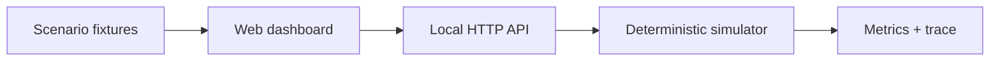

# QueueTwin

**Simulate asynchronous failure modes before they surprise you in production.**

QueueTwin is an open-source, deterministic playground for learning, discussing, and testing messaging-system designs. Its first vertical slice models topic → queue → worker → dead-letter queue with probabilistic failures and duplicate delivery. Every simulation produces a reproducible execution trace.

> **Scope warning:** v0.1 is a technology-neutral conceptual model. It does not call AWS, implement SNS/SQS/Kafka semantics, or predict production reliability. See [model boundaries](docs/architecture.md#model-boundaries).

## Try it locally

Requirements: Node.js 20+ and npm. No cloud account, external package installation, database, or API key is needed.

```bash
git clone https://github.com/jjeanevenx/queuetwin.git
cd queuetwin
npm run dev
```

Open `http://127.0.0.1:4173`. Until the repository is published, run the same commands from your local source directory without cloning.

Run checks:

```bash
npm run check
npm test
npm run smoke
```

## What works in v0.1

- Reproducible runs with an explicit pseudorandom seed.
- Configurable logical-message count, maximum attempts, failure rate and duplicate-copy rate.
- Trace for publication, enqueue, processing attempts, retries and DLQ outcomes.
- Separate successful-copy count and unique-logical-message count.
- Three sample scenarios and a browser dashboard.
- Small HTTP JSON API suitable for local experiments.
- Zero runtime dependencies and no production credentials.

### Example API call

```bash
curl -s http://127.0.0.1:4173/api/simulate \
  -H 'content-type: application/json' \
  -d '{"name":"Retry lab","messageCount":10,"maxAttempts":3,"failureProbability":60,"duplicateProbability":20,"seed":42}'
```

See [API contract](docs/api.md) for bounds and response meanings.

## Where the project is going

QueueTwin will evolve into a scenario-based simulation workbench for message-driven architectures:

1. **M0 — Deterministic core and UI:** topic/queue/worker/DLQ, trace, seed, input validation. Implemented.
2. **M1 — Editable topologies:** graph schema and flow editing with deterministic routing.
3. **M2 — Provider-specific models:** explicitly versioned SNS/SQS Standard/FIFO semantics, visibility timeout, backoff, partial-batch failure; independent verification against official behavior.
4. **M3 — Failure experiments:** outages, throttling, poison messages, idempotency strategies, redrive and backpressure.
5. **M4 — Scenario sharing:** import/export of portable JSON, comparison reports and CI automation.
6. **M5 — Optional adapters:** safe read-only import of infrastructure definitions and a separately designed .NET integration.

Detailed milestones and acceptance gates: [roadmap](docs/roadmap.md).

## Architecture



The pure engine lives in `packages/simulator`. The browser app lives in `apps/web`; its local HTTP host in `scripts/dev.mjs` is **development-only** and intentionally exposes no auth or hosted SaaS functionality.

```text
apps/web/                     Accessible dashboard
packages/simulator/src/       Pure deterministic simulation engine
scripts/                      Local server and smoke test
tests/                        Engine tests
examples/scenarios/           Reproducible scenario fixtures
docs/                         PRD, architecture, ADRs, API, roadmap
docs/ai/                      Shared task context and agent handoff
.claude/                      Claude Code skills and review agents
.github/                      CI, issue and PR templates
```

## Working with AI assistants

QueueTwin treats context, decision records and test evidence as repository artifacts:

- [`AGENTS.md`](AGENTS.md): shared operating instructions for Codex, Claude Code, Copilot and other agents.
- [`CLAUDE.md`](CLAUDE.md): Claude Code entrypoint.
- [Task board](docs/ai/TASKS.md), [handoff](docs/ai/HANDOFF.md) and [decisions](docs/ai/DECISIONS.md): persistent context across sessions.
- `.claude/skills/` and `.claude/agents/`: repeatable procedures and focused reviews.

Read [AI development workflow](docs/ai/WORKFLOW.md) before asking an agent to implement an issue.

## Contributing

Issues, scenarios, tests, documentation and code contributions are welcome. Start with [CONTRIBUTING.md](CONTRIBUTING.md). Changes to provider semantics need official-source references and conformance tests. Do not upload real customer payloads, secrets or production logs.

## Language

The code, canonical technical documentation and UI are in English to support worldwide contributions. A [Portuguese overview](README.pt-BR.md) is available. Localization can expand after the core model stabilizes.

## License

MIT — see [LICENSE](LICENSE).
