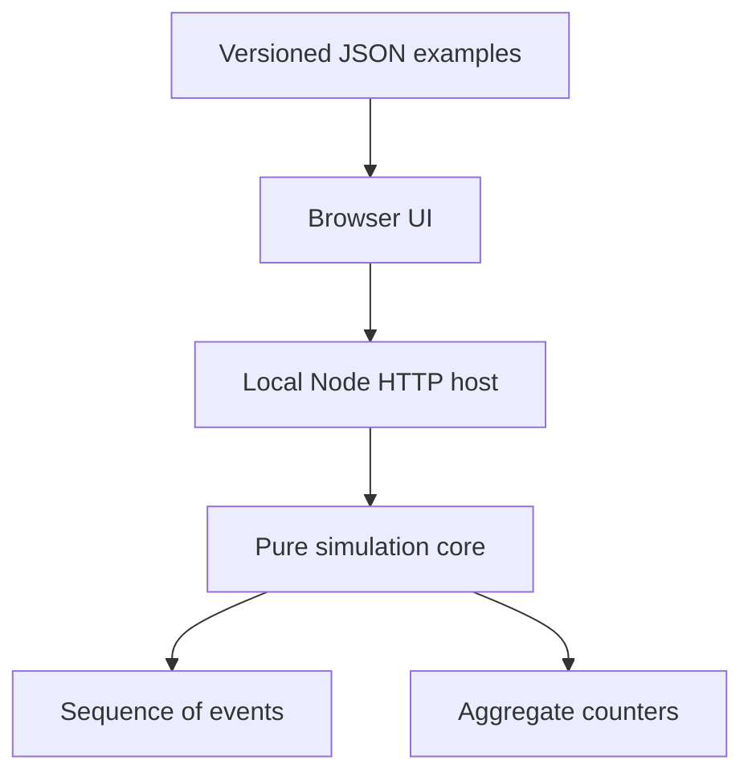
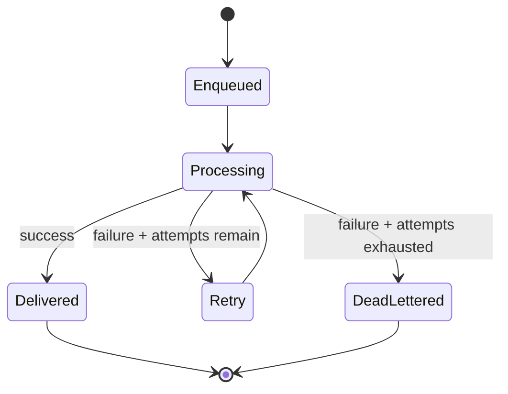

# Architecture and simulation semantics

## Current system



The simulator is deliberately pure (`simulate(input) -> result`). It does not read the wall clock, network, filesystem or environment. The HTTP host owns request parsing and input limits. The UI owns presentation and form state.

### Boundaries

| Module | Responsibility | Must not do |
| --- | --- | --- |
| `packages/simulator` | Validation, seeded PRNG, transitions, trace, metrics | DOM, HTTP, provider SDK calls |
| `scripts/dev.mjs` | Local static host, JSON API, body limit | Business rules, cloud mutations |
| `apps/web` | Scenario input, views, readable trace | Recalculate simulation metrics |
| `examples/scenarios` | Portable deterministic inputs | Real credentials or customer data |

### Logical sequence

For each logical message, the engine records publication and enqueue, optionally produces one duplicate delivery copy, and processes each copy until it succeeds or exhausts its configured attempts. A failed attempt either schedules an immediate abstract retry or routes the copy to DLQ.



## Metrics and invariants

`published`: distinct logical messages emitted once.

`enqueued`: delivery copies inserted in the conceptual queue (including duplicates).

`duplicateCopies`: count of additional copies, at most one per logical message in M0.

`attempts`: number of worker processing attempts across copies.

`delivered`: **successful delivery copies**, not distinct message IDs.

`uniqueDelivered`: number of distinct logical IDs for which at least one copy succeeded.

`failedAttempts`: failed worker attempts.

`retriesScheduled`: retry transitions (not unique messages).

`deadLettered`: delivery copies that exhausted attempts.

In M0, all processing is terminal for each copy; therefore:

```
enqueued = delivered + deadLettered
attempts = delivered + failedAttempts
failedAttempts = retriesScheduled + deadLettered
published + duplicateCopies = enqueued
uniqueDelivered <= published
```

These invariants are asserted by automated tests over multiple seeds and probability values.

## Model boundaries

**This implementation does not simulate real AWS SNS/SQS behavior.** The terms SNS Topic, SQS Queue and DLQ are currently educational labels for generic topology roles. Specifically:

- No visibility timeout, FIFO message group, deduplication window, long polling or batch processing.
- No concurrency, partial failures, backoff, eventual consistency, ordering or network latency.
- Every logical message is enqueued once plus at most one additional copy.
- Every copy eventually succeeds or reaches DLQ within the configured finite attempts.
- A duplicate can be successfully delivered twice; idempotency is **not** implicit.
- Failure and duplication rates are independent Bernoulli draws from a seeded pseudo-random stream; they are not empirical estimates.
- `timeMs` is a synthetic logical offset of 12 ms per recorded event and has no latency prediction value.

Future AWS-specific models require their own ADRs, source references and conformance fixtures. Naming a model `SQS` does not make it equivalent to the cloud provider.

## Security model

M0 runs locally on `127.0.0.1` by default and is **not production-hardened for public hosting**. HTTP requests have a 16 KiB JSON size limit; scenarios cap to 1,000 logical messages and 10 attempts. The UI uses DOM text nodes for untrusted trace text. No credentials are stored or requested.

Before a hosted version: add authentication, rate limiting, bounded compute, telemetry minimization, strict CORS/origin policy, deployment isolation, abuse protections and privacy review. No imported customer payloads may be persisted by default.

## Target direction (not implemented)

The long-term architecture retains a pure deterministic engine and exposes versioned JSON contracts. A separately planned .NET API and an AWS infrastructure adapter may be introduced once provider-specific model semantics are tested. Adapters are optional and must default to read-only import; no permission to mutate cloud infrastructure is implied.
